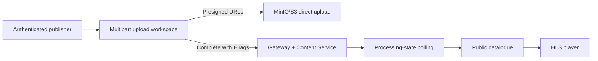

# Streamline Web Client

The Streamline client is the browser experience for the video platform. It makes the backend workflow visible: catalogue browsing and HLS playback are public, while authenticated publisher flows coordinate multipart uploads and asynchronous processing state.

For the full system design, start with the backend [architecture documentation](https://github.com/Ajaychandran0/netflix_backend/blob/main/docs/architecture.md).

## Features

- Public published-video catalogue
- HLS playback with native browser support and `hls.js` fallback
- Sign-up, sign-in, profile, and JWT-backed API requests
- Publisher upload workspace with multipart source upload progress
- Processing-state polling for a publisher's own jobs
- Responsive Material UI interface designed to explain the pipeline, not just play media

## Local setup

```bash
npm install
```

Create `.env`:

```dotenv
VITE_API_BASE_URL=http://localhost:3000
```

Then run:

```bash
npm run dev
```

The Vite URL is normally `http://localhost:5173`. Start the backend stack first; see [local development](../netflix_backend/docs/local-development.md).

## Scripts

| Command | Purpose |
| --- | --- |
| `npm run dev` | Start Vite development server |
| `npm run build` | Type-check and create a production build |
| `npm run lint` | Run ESLint |
| `npm run preview` | Serve the production build locally |

## Frontend flow



The browser does not receive MinIO credentials. It receives temporary presigned URLs and uploads each file part directly to object storage.

## Code structure

```text
src/
├── components/      # Shared header/layout, upload UI, HLS player
├── hooks/           # Authentication, upload, public videos, personal upload status
├── pages/           # Catalogue, authentication, profile, upload workspace, dashboard
├── services/        # Axios API clients grouped by domain
├── store/           # Redux authentication state
├── styles/          # Material UI theme and global styling
├── types/           # API-facing TypeScript models
└── utils/           # Multipart chunking and API-error helpers
```

## MVP access model

Published videos are viewable without a token. Uploading is currently an `ADMIN`-gated UI workflow. A production system should replace this coarse role gate with a server-enforced publisher entitlement and keep the content service inaccessible from the public network.

## Verification checklist

```bash
npm run lint
npm run build
```

For end-to-end verification, register/sign in, upload a small video as an authorized publisher, observe the processing state, and play the completed HLS stream from the catalogue.
